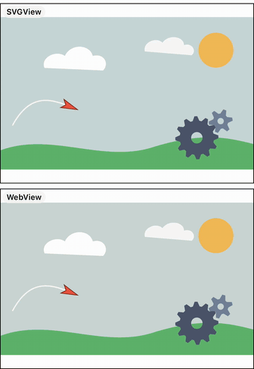

# SVGUIView

[](https://swiftpackageindex.com/nnabeyang/SVGUIView)
[](https://swiftpackageindex.com/nnabeyang/SVGUIView)

An UIView that displays a single SVG image in your interface.

## Documentation

The documentation is hosted on the [Swift Package Index](https://swiftpackageindex.com/nnabeyang/SVGUIView/documentation/svguiview).

## Demo

SVGUIView plays the CSS and SMIL animations of an SVG document. The recording
shows [docs/demo.svg](docs/demo.svg) played by SVGView (top) and by WebKit
(bottom) at the same time in the simulator.

| SVG (in your browser) | SVGUIView and WebKit |
|---|---|
|  |  |

## Usage

Creating a SVGUIView:
```
let data = Bundle.main.url(forResource: "example", withExtension: "svg")!
let svgView = SVGUIView(contentsOf: data)!
view.addSubView(svgView)
```

Playing the animations of the document:
```swift
svgView.configuration = SVGUIViewConfiguration(animation: .play)
```

## Installation

### SwiftPM

Add the `SVGUIView` as a dependency:

```swift
let package = Package(
    // name, platforms, products, etc.
    dependencies: [
        // other dependencies
        .package(url: "https://github.com/nnabeyang/SVGUIView", from: "0.30.1"),
    ],
    targets: [
        .executableTarget(name: "<executable-target-name>", dependencies: [
            // other dependencies
                .product(name: "SVGUIView", package: "SVGUIView"),
        ]),
        // other targets
    ]
)
```

### CocoaPods

Add the following to your Podfile:

```terminal
pod 'SVGUIView'
```

## License

SVGUIView is published under the MIT License, see LICENSE.

## Author
[Noriaki Watanabe@nnabeyang](https://bsky.app/profile/did:plc:bnh3bvyqr3vzxyvjdnrrusbr)
